# Flyback Converter (LT8306)

Isolated flyback converter board (REV 0.1) built around the Analog Devices
LT8306 no-opto flyback controller, together with its LTspice and PLECS models.
The silkscreen rates it for a 3–36 VDC input and a 12 VDC / 2 A output. The
PLECS model adds thermal, core-loss, clamp and snubber models and a Python
parameter sweep.

| 3D view | 2D layout |
| --- | --- |
| [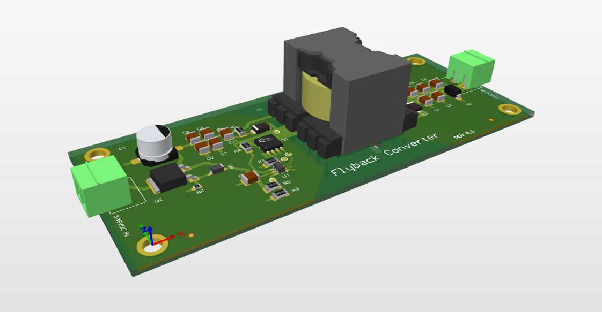](images/pcb-3d-view.png) | [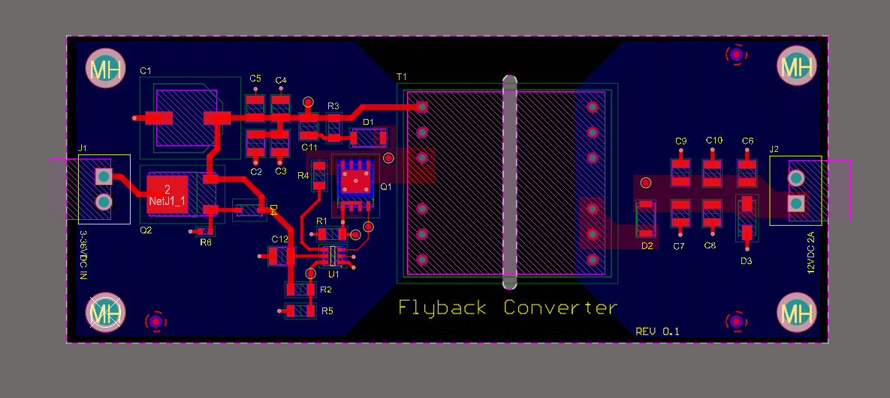](images/pcb-layout-2d.png) |

[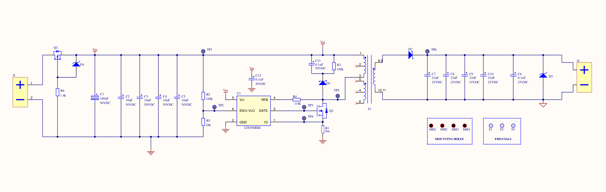](images/schematic.png)

## On the board

| Ref | Part | Role |
| --- | --- | --- |
| U1 | LT8306RS6 | No-opto flyback controller (primary-side regulation) |
| Q1 | Infineon BSC190N12NS3 G, 120 V | Primary switch |
| R1 | Susumu KRL3216E 6 mΩ | Current-sense resistor |
| T1 | Sumida 11328-T078 | Flyback transformer |
| D1, D2 | Nexperia PMEG6045ETP | Schottky diodes (clamp and output rectifier) |
| C7–C10, C6 | 4× 22 µF + 0.1 µF, 25 V | Output capacitors |
| D3 | onsemi 1SMA5928B, 13 V | Output clamp zener |
| Q2, D4, R6 | Vishay IRFR9014 P-MOSFET + BZT52C10 + 1.4 kΩ | Reverse-polarity protection ([detail](images/reverse-polarity-protection.png)) |
| C1–C5 | 100 µF electrolytic + 4× 10 µF, 50 V | Input capacitors |
| R2, R5 | 100 kΩ / 28 kΩ | EN/UVLO divider |
| R4 | 118 kΩ | RFB feedback resistor |
| J1, J2 | 2-way 3.81 mm terminal blocks | Input / output |

## Simulation

| LTspice, single output | LTspice, dual output |
| --- | --- |
| [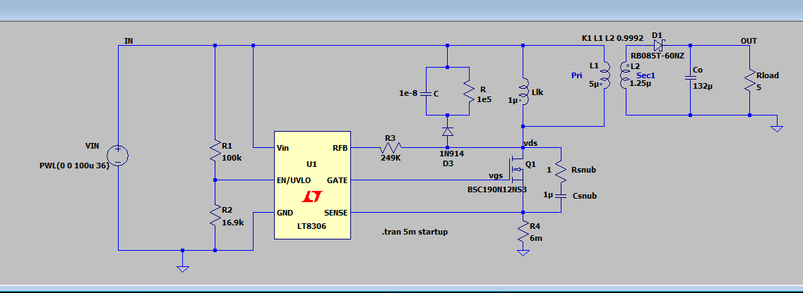](images/ltspice-schematic-single-output.png) | [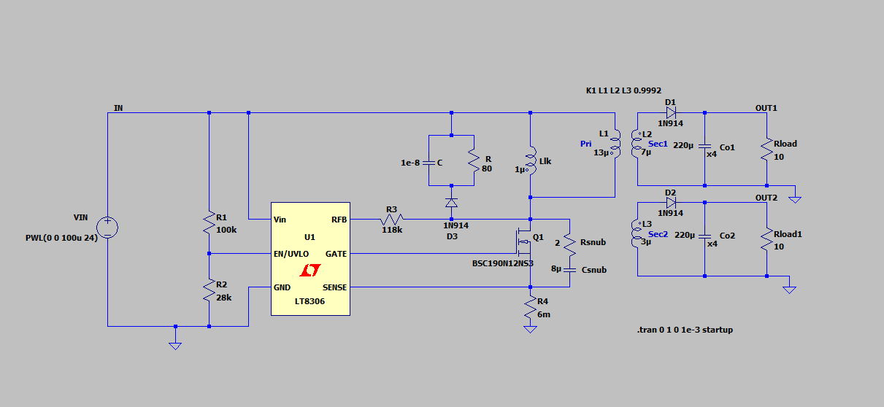](images/ltspice-schematic-dual-output.png) |

[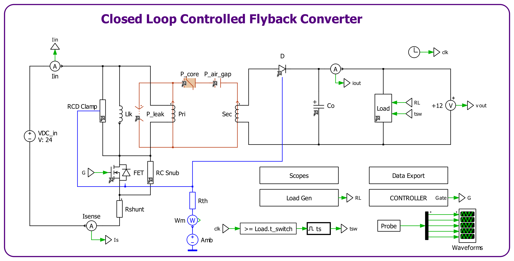](images/plecs-flyback-model.png)

| Controller | MOSFET model | RCD clamp | RC snubber |
| --- | --- | --- | --- |
| [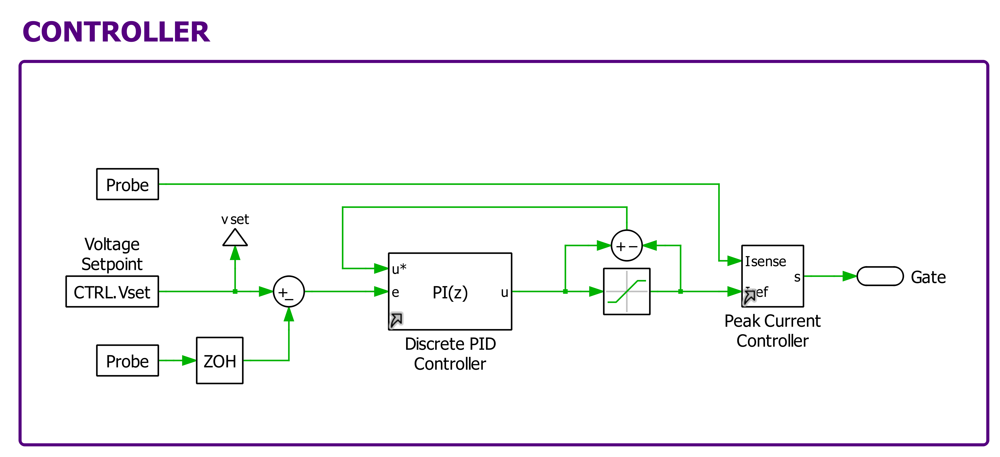](images/plecs-controller.png) | [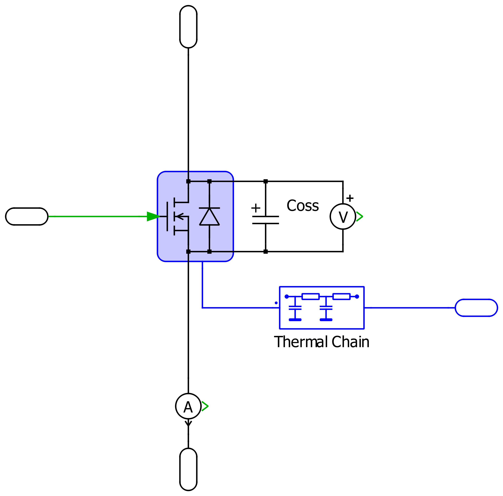](images/plecs-mosfet-model.png) | [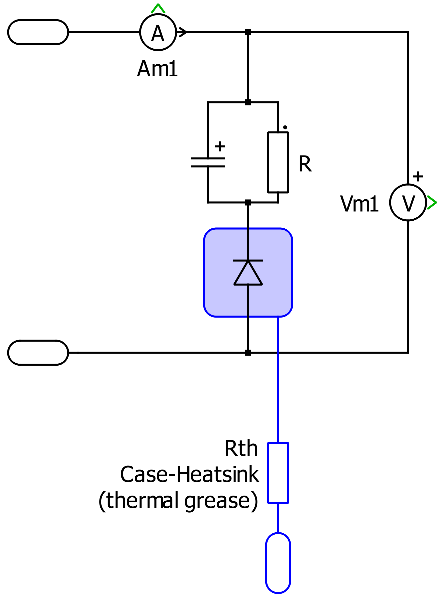](images/plecs-rcd-clamp.png) | [](images/plecs-rc-snubber.png) |

| Load generator | Load calculation | Scopes | Data export |
| --- | --- | --- | --- |
| [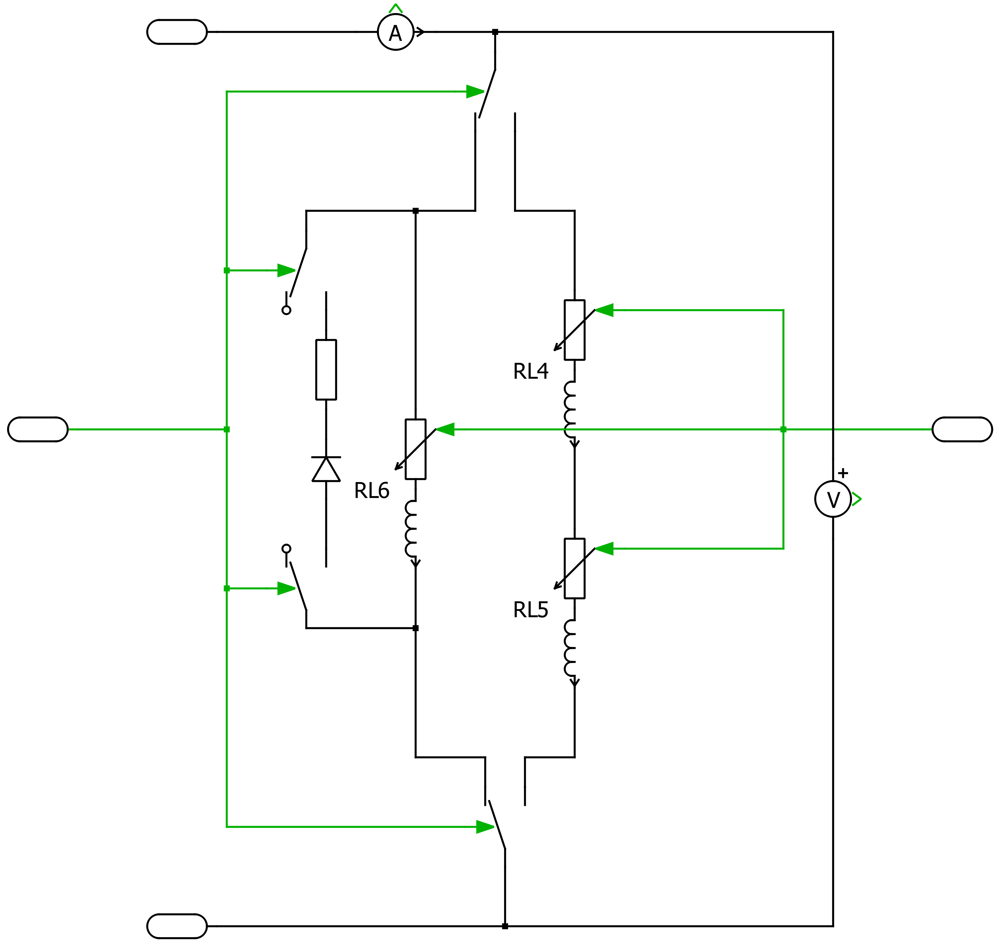](images/plecs-load-generator.png) | [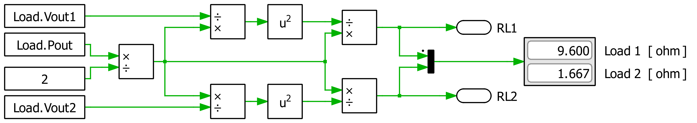](images/plecs-load-calculation.png) | [](images/plecs-scopes.png) | [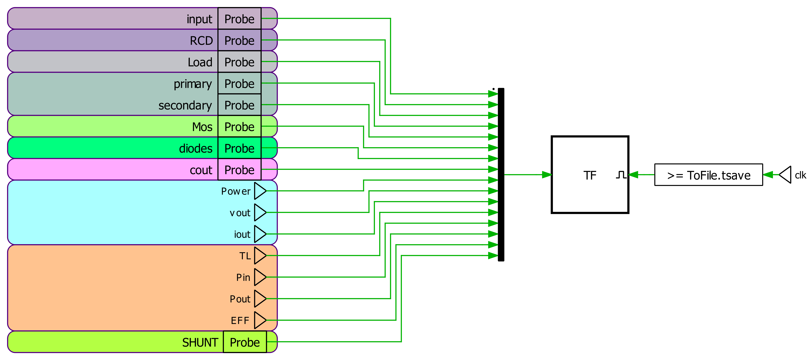](images/plecs-data-export.png) |

Snubber voltage over a parameter sweep, and the generated sweep report:

[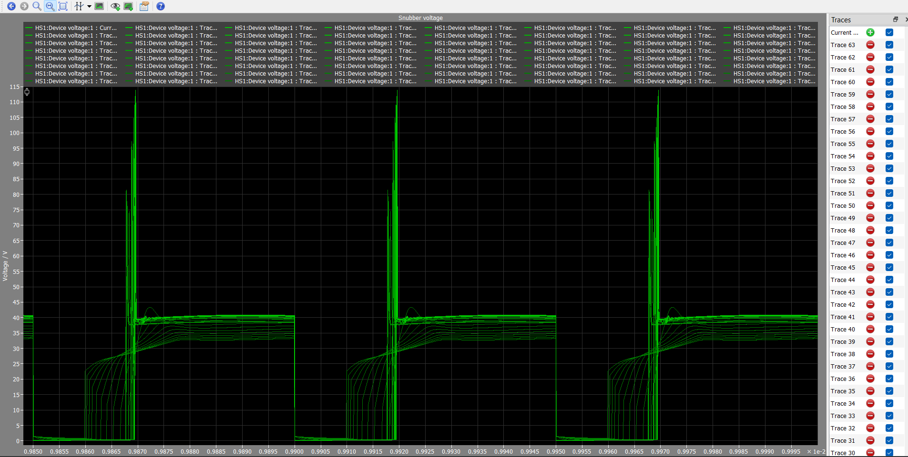](images/plecs-snubber-voltage-sweep.png)

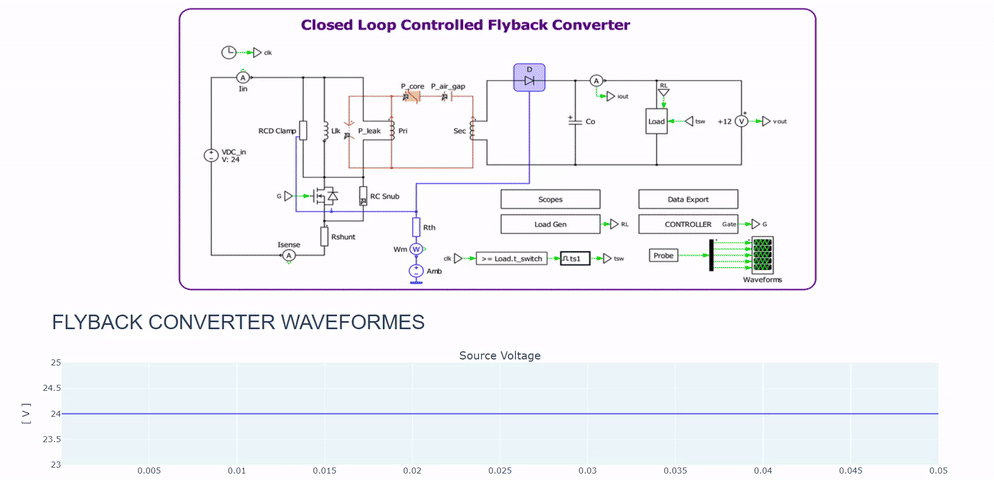

`docs/flyback-converter-mosfet-model.pdf` documents the MOSFET model.

## Repository layout

```
0014_flyback_converter/
├── PCB/                             # Altium Designer project
│   ├── flyback.PrjPcb               # Project file (open this)
│   ├── flyback.SchDoc               # Schematic
│   ├── flyback.PcbDoc               # PCB layout
│   ├── flyback.OutJob               # Output job
│   ├── BOM.xlsx, flyback.pdf        # BOM and schematic PDF
│   └── Project Outputs for flyback/ # Gerbers, drill, STEP, DXF, reports
├── PLECS/                           # PLECS model + Python sweep / post-processing scripts
├── SPICE/                           # LTspice model (flyback.asc)
├── docs/                            # MOSFET model write-up
└── images/                          # Renders and screenshots used in this README
```

## Component library

This repo stores no libraries. Every part comes from the general Altium library
in [Gueni/0000_libraries](https://github.com/Gueni/0000_libraries):

| File | Used for |
| --- | --- |
| [`Altium/DATABASE.DbLib`](https://github.com/Gueni/0000_libraries/blob/master/Altium/DATABASE.DbLib) | Database library the schematic components link to |
| [`Altium/DB.mdb`](https://github.com/Gueni/0000_libraries/blob/master/Altium/DB.mdb) | Parts database (part numbers, MPNs, suppliers) |
| [`Altium/SCH.SchLib`](https://github.com/Gueni/0000_libraries/blob/master/Altium/SCH.SchLib) | Schematic symbols |
| [`Altium/FTP.PcbLib`](https://github.com/Gueni/0000_libraries/blob/master/Altium/FTP.PcbLib) | PCB footprints and 3D models |

### Setup

The project finds the library through a relative path, so clone both repos side
by side in the same workspace folder:

```
WORKSPACE/
├── 0000_libraries/                   # git clone https://github.com/Gueni/0000_libraries.git
└── 0014_flyback_converter/           # this repo
```

The project file references `..\..\0000_libraries\Altium\DATABASE.DbLib` and
adds `..\..\0000_libraries\Altium\` as a library search path. The DbLib's
database path is absolute (`D:\WORKSPACE\0000_libraries\Altium\DB.mdb`); see the
[library README](https://github.com/Gueni/0000_libraries#setup) if your
workspace lives elsewhere.
